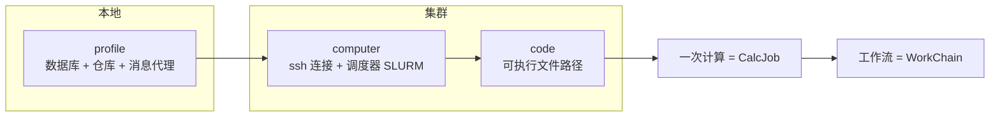
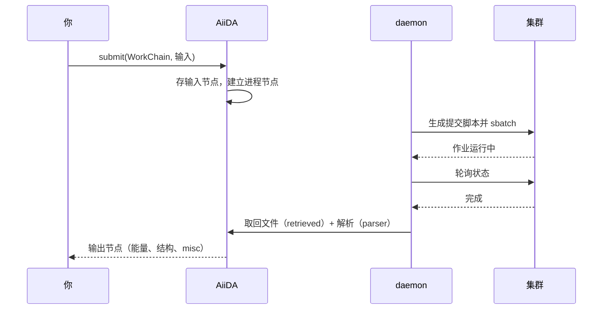

# AiiDA 使用方式：给人看的总结

> 这一页不讲怎么敲命令，只讲**AiiDA 是怎么运转的、你该在什么时候做什么**。
> 命令细节见 `references/02-installation.md`（安装）和 `references/03-usage-*.md`（使用）。
> 如果你只读一页，读这页。

---

## 1. AiiDA 到底解决什么问题

跑第一性原理计算的人都会遇到四个麻烦：

1. **提交**：每个代码的输入文件（INCAR / INPUT / STRU）、排队脚本、墙钟、核数都不一样，手写脚本容易错；
2. **重跑**：算到一半被杀、SCF 不收敛、换参数再来一遍，全靠人记；
3. **追溯**：三个月后想知道"这个能量是用什么参数、什么赝势、哪版代码算的"，往往查不出来；
4. **批量**：几十个结构 × 几种参数组合，手动提交不现实，失败了也不知道哪几个。

AiiDA 的做法是把这四件事都变成**数据库里的记录**：

- 你不再"写脚本 → 提交 → 看日志"，而是**描述一次计算需要哪些输入**，交给 AiiDA；
- AiiDA 把每次计算的输入、输出、状态、耗时、报错全部存成节点（Node），节点之间连成一张**溯源图**（provenance graph）；
- 计算失败时，工作流（WorkChain）可以**按预设策略重试**（改混合参数、调大墙钟、从上一步结构续算），而不是整段重来；
- 想要"用同样设置再算一遍别的结构"，只需换一个输入节点。

一句话：**AiiDA = 计算任务的数据库 + 可编程的作业调度器**。它不负责算，负责"算得可复现、可追溯、可批量、可重试"。

---

## 2. 三个配置：profile、computer、code

AiiDA 的一切都建立在三层配置上，缺一层就跑不起来。理解这三层，安装和使用就没有秘密。



| 层 | 回答的问题 | 常见配置项 | 出错时的典型症状 |
|---|---|---|---|
| **profile** | 数据存哪？ | 数据库（PostgreSQL / SQLite）、仓库目录、RabbitMQ | `Could not determine the current profile` |
| **computer** | 作业提交到哪台机器、用什么调度器？ | 主机名、ssh、`core.slurm`、工作目录、`mpirun` 命令 | `Computer test` 失败、连不上、`sbatch: command not found` |
| **code** | 跑哪个可执行文件？ | 绝对路径、`prepend-text`（module/spack）、MPI 开关 | `Code not found`、运行时缺库、`No partition specified` |

三个都是**一次性配置、长期复用**的。配置好后，你日常只跟"节点"和"工作流"打交道。

---

## 3. 一次计算的一生



关键点：

- **提交和执行是分开的**：`submit()` 只是把进程写进数据库并排队；真正干活的是**守护进程 daemon**。所以提交完关掉终端没关系，但 `verdi daemon status` 必须是 running。
- **文件在集群，结果在本地**：`retrieved` 是取回本地的文件夹（OUTCAR、running_scf.log…），`remote_folder` 是集群上的原始路径。
- **每个进程都有 exit code**：`0` = 成功；非 0 = 失败且**含义由插件定义**（例如 ABACUS 的 302 是"电子步不收敛"、301 是"没跑完就被杀"）。看 `verdi process show <pk>` 的 state 和 exit status，再看 `verdi process report <pk>` 的日志。
- **节点是不可变的**：存进数据库的输入/输出不会变。想改参数，是**新建一次计算**，不是修改旧记录——这正是可复现性的来源。

---

## 4. 两种用法：先 workflow，再 scripts

这是使用 AiiDA 的核心分层，也是本仓库的组织方式。

### 4.1 workflow 层：定义"一次计算长什么样"

工作流（WorkChain）是**可重试的多步流程**。你不需要从零写，通常直接用插件里现成的：

```bash
verdi plugin list aiida.workflows        # 列出所有可用的工作流
verdi plugin list aiida.workflows vasp.v2.relax   # 看它需要哪些输入端口
```

例如 `vasp.v2.relax`：给定结构和参数，它自动完成 SCF → 弛豫 → 收敛检查 → 必要时重启。你只提供输入，不写流程。

跨代码对比时，用 `aiida-common-workflows` 的统一接口：同一套输入（结构 + `protocol` + `relax_type` + `kpoints_spacing`）可以分别交给 VASP / QE / FLEUR 等已注册的后端跑，结果可比较；协议档 `fast / moderate / precise` 决定精度档次。（ABACUS 目前没有注册成 common-workflows 后端，直接用插件自带的 `abacus.relax`。）

**workflow 层的产出**：一个能跑、能重试、能追溯的进程节点（及它的子节点树）。

### 4.2 scripts 层：批量提交 + 分析

有了 workflow，剩下的就是"怎么成批地用"和"结果怎么分析"，这正是 `acwf-verification-scripts` 那套脚本干的事：

```
2-submit/    批量提交（SubmissionController：并发上限、断点续跑、按 extras 去重）
3-analyze/   从输出节点提取能量/结构 → 拟合 → 出图 → 写 JSON
4-export/    整组结果打包归档
```

**scripts 层不关心计算怎么跑**，只调用 `submit()` 和读 `outputs`。所以：

- 换代码、换参数 → 只改 workflow 的输入；
- 换系统规模、换批处理策略 → 只改 scripts；
- 两者解耦，各自可以独立演进。

> **顺序很重要**：先把 workflow 跑通（单个结构、`fast` 协议、小体系），再写 scripts 批量。反过来做，一旦 workflow 有问题，批量提交的几十个作业会一起失败。

---

## 5. 你应该怎么用（速查）

| 我想… | 做什么 | 命令/入口 |
|---|---|---|
| 确认环境没问题 | 看 daemon、profile、computer、code 是否就绪 | `verdi status`、`install/06-doctor.py` |
| 跑第一次计算 | 用最简单的工作流 + 小体系 + `fast` 协议 | `references/03-usage-workflow.md` |
| 看有哪些工作流可用 | 列插件 | `verdi plugin list aiida.workflows` |
| 看某个工作流要什么输入 | 看端口 | `verdi plugin list aiida.workflows <name>` |
| 提交 | 构造 inputs 后 `submit()` | `examples/si-scf/submit.py` |
| 盯进度 | 列表 / 状态 / 报告 | `verdi process list -a`、`verdi process status <pk>` |
| 分析结果 | 读 outputs，拟合/画图 | `examples/si-scf/analyze.py` |
| 出错了 | 三层排查（配置 / 插件 / 代码） | `references/04-troubleshooting.md` |
| 上游插件有 bug | 最小复现 → issue → PR | `references/04-troubleshooting.md` |

---

## 6. 出错了怎么办：三层排查

按"从外到内"的顺序看，不要一上来就怀疑 DFT 代码：

```
① 参数/配置层   →  ② 插件（aiida-core / aiida-vasp / aiida-abacus）层  →  ③ DFT 代码层
   profile/computer/code      WorkChain 端口、parser、handler            SCF/弛豫/内存/MPI
```

- **① 配置层**：症状是"根本没提交上去"或"连不上"。比如 `sbatch: No partition specified`（没给队列）、`Computer test` 失败、`Code not found`。先看 `verdi process report <pk>` 的异常栈，再看子作业的 `metadata.options` 是否为 `None`。
- **② 插件层**：症状是"提交上去了，但插件自己抛异常/端口对不上/解析不到字段"。做法是**最小复现**（十行脚本 + 一个结构），然后对照上游仓库的 main 分支，确认是 bug 就开 issue 提 PR，附带复现脚本和回归测试。
- **③ 代码层**：症状是"作业跑完了/被杀/报错，但 AiiDA 只是如实记录"。这时**看 exit code**：
  - ABACUS：`301` 没跑完（墙钟/MPI/OOM）、`302` SCF 不收敛、`303` 离子步不收敛、`401` 重试耗尽；
  - VASP：`700` 没跑完（常见 ZBRENT）、`501` 电子步问题等；
  - 调度器：`DUE TO TIME LIMIT`、`Signal 9`（OOM）。
  - 细节和真实案例见 `troubleshooting/exit-codes.md` 与 `troubleshooting/cases/`。

排查完，**把这次的坑写成一条 case YAML**（模板见 `troubleshooting/cases/`），仓库就是这么一点点长起来的。

---

## 7. 这份仓库的边界

- 它**不教 DFT**：INCAR/INPUT 里的物理参数怎么选，是你自己的事；
- 它**不替代官方文档**：`aiida-core` 的接口、插件端口名以 `verdi plugin list` 和上游 release notes 为准；
- 它**会过时**：`versions.yaml` 记录了这套流程验证过的版本组合，`install/06-doctor.py` 会告诉你当前环境还在不在支持范围内。
