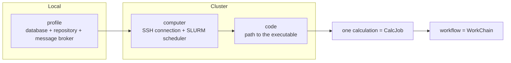
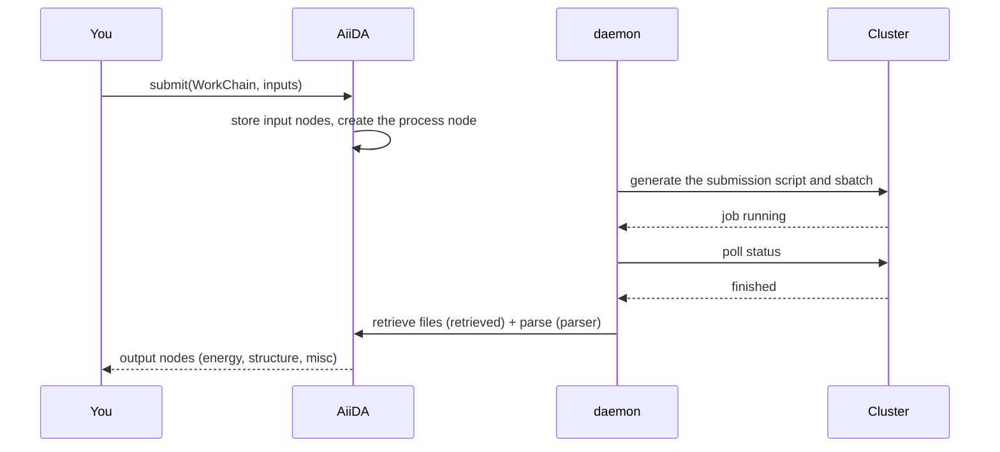

# AiiDA Usage: A Summary for Humans

> This page does not explain which commands to type; it only explains **how AiiDA works and what you should do when**.
> For command details see `references/02-installation.md` (installation) and `references/03-usage-*.md` (usage).
> If you read only one page, read this one.

---

## 1. What problem does AiiDA actually solve

Anyone running first-principles calculations runs into four nuisances:

1. **Submission**: every code has different input files (INCAR / INPUT / STRU), queue scripts, wall time, and core counts; hand-written scripts are error-prone;
2. **Re-running**: a job killed halfway, SCF not converging, changing a parameter and starting over — all of it depends on human memory;
3. **Traceability**: three months later you want to know "which parameters, which pseudopotential, which version of the code produced this energy" — and often you cannot find out;
4. **Batching**: dozens of structures × several parameter combinations; manual submission is unrealistic, and when something fails you don't know which ones.

AiiDA's approach is to turn all four into **records in a database**:

- You no longer "write a script → submit → read logs"; instead you **describe which inputs a calculation needs** and hand it to AiiDA;
- AiiDA stores every calculation's inputs, outputs, state, elapsed time, and errors as nodes, and the nodes are connected into a **provenance graph**;
- When a calculation fails, the WorkChain can **retry according to a predefined policy** (mix parameters, raise the wall time, continue from the previous structure), instead of starting the whole thing over;
- To "run another structure with the same settings", you just swap in a different input node.

One sentence: **AiiDA = a database for computational tasks + a programmable job scheduler**. It does not do the computing; it makes computing reproducible, traceable, batchable, and retryable.

---

## 2. The three configurations: profile, computer, code

Everything in AiiDA rests on three layers of configuration; without any one of them nothing runs. Once you understand these three layers, installation and usage hold no secrets.



| Layer | Question it answers | Common settings | Typical symptom when it breaks |
|---|---|---|---|
| **profile** | Where is the data stored? | database (PostgreSQL / SQLite), repository directory, RabbitMQ | `Could not determine the current profile` |
| **computer** | Which machine do jobs go to, and with which scheduler? | hostname, ssh, `core.slurm`, working directory, `mpirun` command | `Computer test` fails, cannot connect, `sbatch: command not found` |
| **code** | Which executable is run? | absolute path, `prepend-text` (module/spack), MPI flag | `Code not found`, missing libraries at runtime, `No partition specified` |

All three are **configured once and reused long-term**. Once they are set up, your day-to-day work only involves "nodes" and "workflows".

---

## 3. The life of one calculation



Key points:

- **Submission and execution are separate**: `submit()` only writes the process into the database and queues it; the actual work is done by the **daemon**. So it is fine to close the terminal after submitting, but `verdi daemon status` must be running.
- **Files live on the cluster, results live locally**: `retrieved` is the folder copied back locally (OUTCAR, running_scf.log…), `remote_folder` is the original path on the cluster.
- **Every process has an exit code**: `0` = success; non-zero = failure and **the meaning is defined by the plugin** (for example, ABACUS's 302 is "electronic steps did not converge", 301 is "killed before finishing"). Look at the state and exit status from `verdi process show <pk>`, then the log from `verdi process report <pk>`.
- **Nodes are immutable**: inputs/outputs stored in the database do not change. To change a parameter you **create a new calculation**, not modify an old record — this is exactly where reproducibility comes from.

---

## 4. Two ways to work: first workflows, then scripts

This is the core layering of using AiiDA, and also how this repository is organized.

### 4.1 The workflow layer: defining "what one calculation looks like"

A WorkChain is a **retryable multi-step process**. You don't need to write one from scratch; usually you just use the ones already provided by the plugins:

```bash
verdi plugin list aiida.workflows        # list all available workflows
verdi plugin list aiida.workflows vasp.v2.relax   # see which input ports it needs
```

For example `vasp.v2.relax`: given a structure and parameters, it automatically does SCF → relaxation → convergence check → restart if needed. You only supply inputs; you don't write the flow.

When comparing across codes, use the unified interface of `aiida-common-workflows`: the same set of inputs (structure + `protocol` + `relax_type` + `kpoints_spacing`) can be handed to registered backends such as VASP / QE / FLEUR and the results are comparable; the protocol level `fast / moderate / precise` sets the accuracy tier. (ABACUS is not currently registered as a common-workflows backend; use the plugin's own `abacus.relax` directly.)

**What the workflow layer produces**: a process node that runs, retries, and can be traced (plus its tree of child nodes).

### 4.2 The scripts layer: batch submission + analysis

With the workflow in place, what remains is "how to use it in batches" and "how to analyze the results" — exactly what the `acwf-verification-scripts` set of scripts does:

```
2-submit/    batch submission (SubmissionController: concurrency limit, resume from checkpoints, dedupe by extras)
3-analyze/   extract energy/structure from output nodes → fit → plot → write JSON
4-export/    package and archive a whole set of results
```

In this repository, `examples/eos-scan/` is the minimal pair: `workflow.py` only describes (structure / backend / protocol / number of volumes), while `submit.py` and `analyze.py` only submit and read results — the same `make_builder()`, so what was validated is what gets submitted.

**The scripts layer doesn't care how the calculation runs**; it only calls `submit()` and reads `outputs`. Therefore:

- changing code or parameters → change only the workflow inputs;
- changing system size or batching strategy → change only the scripts;
- the two are decoupled and can each evolve independently.

> **Order matters**: get the workflow working first (single structure, `fast` protocol, small system), then write the batch scripts. Do it the other way round and, once the workflow has a problem, the dozens of jobs submitted in batch will all fail together.

---

## 5. How you should use it (quick reference)

| I want to… | Do this | Command/entry point |
|---|---|---|
| Make sure the environment is fine | Check whether daemon, profile, computer, code are ready | `verdi status`, `install/06-doctor.py` |
| Run a first calculation | Use the simplest workflow + small system + `fast` protocol | `references/03-usage-workflow.md` |
| See which workflows are available | List the plugins | `verdi plugin list aiida.workflows` |
| See what inputs a workflow needs | Look at the ports | `verdi plugin list aiida.workflows <name>` |
| Submit | Build the inputs, then `submit()` | `examples/si-scf/submit.py` |
| Watch progress | list / status / report | `verdi process list -a`, `verdi process status <pk>` |
| Analyze results | Read outputs, fit/plot | `examples/si-scf/analyze.py` |
| Write my own WorkChain | outline / exit_code / ToContext / expose / batching | `references/05-workchain-recipes.md` |
| Pull data from nodes, query up/downstream | state attributes / links / QueryBuilder / retrieved | `references/06-node-queries.md` |
| Something broke | three-layer triage (configuration / plugin / code) | `references/04-troubleshooting.md` |
| An upstream plugin has a bug | minimal reproduction → issue → PR | `references/04-troubleshooting.md` |

---

## 6. What to do when something breaks: three-layer triage

Work from the outside in; don't suspect the DFT code first:

```
① parameters/configuration layer  →  ② plugin (aiida-core / aiida-vasp / aiida-abacus) layer  →  ③ DFT code layer
   profile/computer/code             WorkChain ports, parser, handlers                     SCF/relaxation/memory/MPI
```

- **① Configuration layer**: symptoms are "it never got submitted" or "cannot connect". For example `sbatch: No partition specified` (no queue given), `Computer test` failing, `Code not found`. First look at the exception stack from `verdi process report <pk>`, then check whether the child job's `metadata.options` is `None`.
- **② Plugin layer**: symptoms are "it got submitted, but the plugin itself throws / the ports don't match / a field can't be parsed". The approach is a **minimal reproduction** (ten-line script + one structure), then compare against the upstream repository's main branch; if it is a bug, open an issue and submit a PR with the reproduction script and a regression test.
- **③ Code layer**: symptoms are "the job finished / got killed / errored, and AiiDA is merely recording it faithfully". Here you **look at the exit code**:
  - ABACUS CalcJob: `301` did not finish (wall time/MPI/OOM), `302` SCF did not converge, `303` ionic steps did not converge;
    the base WorkChain's `401` is "retries exhausted";
  - VASP CalcJob: `700` did not finish (commonly ZBRENT), `701` electronic steps did not converge, `702` ionic steps did not converge;
    the WorkChain's `501` is "input needs manual change"; the relax WorkChain's `601` is "residual force rose in the last step" (warning);
  - Scheduler: `DUE TO TIME LIMIT`, `Signal 9` (OOM).
  - Details and real cases are in `troubleshooting/exit-codes.md` and `troubleshooting/cases/`.

After triaging, **write this pitfall up as one case YAML** (template in `troubleshooting/cases/`); that is how this repository has grown, bit by bit.

---

## 7. The boundaries of this repository

- It **doesn't teach DFT**: choosing the physics parameters in INCAR/INPUT is your job;
- It **doesn't replace the official docs**: interfaces of `aiida-core` and plugin port names follow `verdi plugin list` and the upstream release notes;
- It **will go stale**: `versions.yaml` records the version combinations this workflow has been validated against, and `install/06-doctor.py` tells you whether your current environment is still within the supported range.
